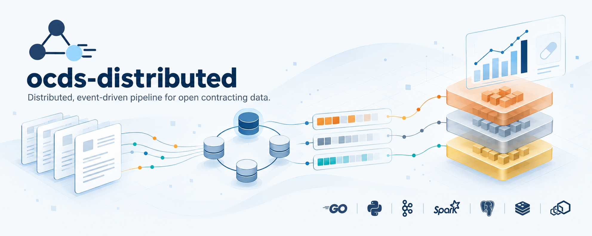
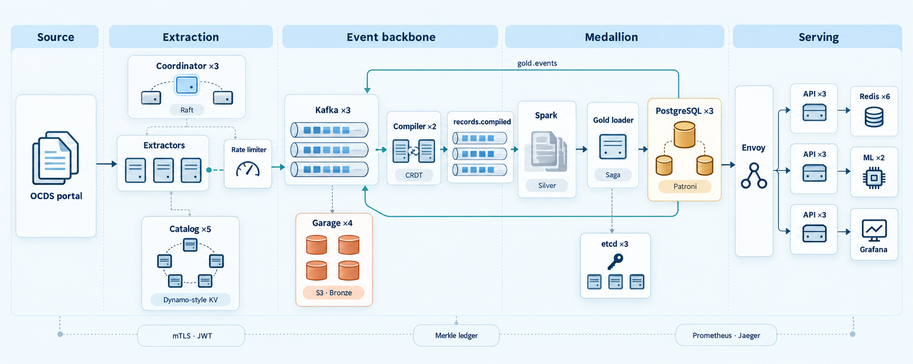

# Distributed Event-Driven Data Platform for Peru's Open Contracting Data

               

`ocds-distributed` ingests, reconciles and analyses the public procurement records of the
[Contrataciones Abiertas portal](https://contratacionesabiertas.oece.gob.pe). It rebuilds the
[essalud-pipeline](https://github.com/angelariasus/essalud-pipeline) Medallion ELT from scratch as
a set of cooperating services in Go and Python, and uses it to answer one question: how efficient
are EsSalud's medicine purchases?

Each mechanism was run live, most of them were broken on purpose, and the results were measured.
The measurements, including the ones that went wrong, are in [`docs/`](docs).

## At a glance

| | |
|---|---|
| Data source | ~2.76 million OCDS records (2004–2026) published as 325 monthly bulk files and a cursor API |
| Validated on | 24 real months of `seace_v3` (October 2024 to September 2026): 160,063 records, 183,492 tender items |
| Services | 11 of our own (7 in Go, 3 in Python, 1 in PySpark) on top of Kafka, Garage, Spark, PostgreSQL/Patroni, etcd, Redis Cluster and Envoy |
| Containers | about 50 with every Compose profile up, on one machine |
| Analysis | EsSalud medicine purchases matched against the Petitorio Farmacológico 2026 |

## Architecture



Raw files land in Bronze (Garage), the compiler merges them into one record per process, Spark
produces Silver, and a saga loads Gold into a Patroni-managed PostgreSQL cluster. The outbox
publishes `gold.events` so the API replicas invalidate their shared cache. The bottom band applies
to everything: mutual TLS and JWT, the Merkle ledger that attests every Bronze file and Gold
load, and Prometheus and Jaeger for observability.

| Component | What it does | Distributed-systems topics |
|---|---|---|
| [`coordinator`](services/coordinator) | Three replicas kept consistent by our own Raft with PreVote, CheckQuorum and persistence. Only the leader plans, through a replicated schedule that a new leader can finish | Consensus, leader election, replicated state machines, work partitioning |
| [`extractor`](services/extractor) | Consumer group that downloads or crawls, verifies checksums, stores and publishes records | Horizontal scaling, rebalancing, at-least-once delivery, idempotency, retries, circuit breaker, dead-letter queue |
| [`limiter`](services/limiter) | gRPC token bucket whose rate adapts with additive-increase/multiplicative-decrease on latency and throttling | RPC, feedback control, graceful degradation |
| [`catalog`](services/catalog) | Dynamo-style key-value store: consistent hashing, N/R/W quorums, vector clocks, hinted handoff, read repair, SWIM gossip, Merkle anti-entropy, write-ahead log | Partitioning, replication, tunable consistency, failure detection, eventual consistency |
| [`compiler`](services/compiler) | Merges every sighting of a process, in any order, into one record modelled as a state-based CRDT stamped with Lamport time | CRDTs, logical clocks, co-partitioning, state restoration from a changelog |
| [`silver`](services/silver) | PySpark batch flattening to one row per tender item, and a streaming query with event-time windows and watermarks | Data parallelism, shuffles, stream processing, late data, exactly-once sinks |
| [`gold`](services/gold) | Classifies medicines against the Petitorio and loads a star schema as a saga with a lease, a fencing token and a transactional outbox | Automatic failover, distributed mutual exclusion, fencing, sagas, outbox instead of 2PC |
| [`api`](services/api) | One query service exposed as gRPC and REST behind Envoy, reading from replicas with a shared cache | Service discovery, load balancing, caching, read scaling, timeouts and retries |
| [`ml`](services/ml) | Lead-time model trained from Gold, published as an immutable versioned artifact, served by gRPC replicas | Model serving, immutable artifacts, client-side load balancing |
| [`ledger`](services/ledger) | Append-only transparency log with Ed25519-signed tree heads, inclusion and consistency proofs | Integrity, tamper evidence, distributed trust through auditors |
| [`ocds-mock`](services/ocds-mock) | Replica of the portal with its measured behaviour, behind Toxiproxy | Fault injection, repeatable experiments |
| Security | Internal certificate authority, mutual TLS on every internal hop, ES256 JWT at the edge, role-based authorization | Secure channels, mutual authentication, authentication vs. authorization |

## Results on real data

The pipeline ran end to end on two years of real data, from download to the EsSalud analysis.
Full scope and method are in [docs/real-data.md](docs/real-data.md).

| EsSalud medicines, Oct 2024 to Sep 2026 | Items | Referential (M soles) | Direct contracting |
|---|---|---|---|
| In the Petitorio | 582 | 1,578.9 | 4.3% |
| Outside the Petitorio | 115 | 154.8 | 53.0% |
| Partial combination | 4 | 5.6 | 0% |

- Out-of-formulary drugs are mostly bought by direct contracting, formulary drugs by reverse auction.
- Formulary drugs are typically awarded at 58% of their referential value; out-of-formulary drugs
  at 100%. Competition lowers prices where it exists.
- Supplier concentration is low: 103 suppliers, Herfindahl-Hirschman index 478.
- The lead-time model reaches a mean absolute error of 17.9 days on the newest data, against 23.2
  for always predicting the median.

Running on real data also exposed a bug inherited from the original project: process amounts were
copied onto every item, inflating EsSalud's medicine total from 1,739 to 12,875 million soles.
It is fixed in Silver and described in [docs/lessons.md](docs/lessons.md).

## Running it

Requirements: Docker with Compose v2, Python 3 and Bash. On Windows use Git Bash and
`export MSYS_NO_PATHCONV=1`. Everything else builds inside containers. The measurements in the
docs come from one laptop with 24 virtual CPUs.

```sh
python scripts/gen_env.py > .env     # random cluster ids and credentials
bash scripts/gen_pki.sh              # internal CA and service certificates in deploy/pki (not committed)
docker compose up -d --build         # extraction layer
bash scripts/plan_now.sh             # plan a round now instead of waiting for PLAN_INTERVAL
```

The plan window lives in `.env` and defaults to two months. The real-data run used
`PLAN_FROM=2024-10` and `PLAN_TO=2026-09`.

The rest of the platform is split into Compose profiles so that only what is needed runs:

| Profile | Services | One-shot jobs (`-jobs` profile) |
|---|---|---|
| default | Kafka ×3, Garage ×4, coordinator ×3, extractor, limiter, catalog ×5, compiler, observability | |
| `sim` | ocds-mock, Toxiproxy | |
| `silver` | Spark master and workers | `silver-batch`, `silver-stream` |
| `gold` | etcd ×3, PostgreSQL ×3 with Patroni, HAProxy, outbox relay | `gold-loader` |
| `serve` | Redis ×6, ml ×2, api ×3, Envoy | `ml-train` |
| `secure` | ledger | `ledger-auditor` |

From compiled records to answers:

```sh
docker compose --profile silver up -d --scale spark-worker=2
docker compose --profile silver --profile silver-jobs run --rm silver-batch

docker compose --profile gold up -d
docker compose --profile gold --profile gold-jobs run --rm gold-loader

docker compose --profile serve up -d
docker compose --profile serve --profile serve-jobs run --rm ml-train

TOKEN=$(bash scripts/mint_token.sh analyst)
curl -H "Authorization: Bearer $TOKEN" 'localhost:8090/v1/top-buyers?year=2026&limit=5'
curl -H "Authorization: Bearer $TOKEN" -X POST localhost:8090/v1/predict/lead-time \
  -d '{"monto_referencial":250000,"metodo":"open","categoria":"goods","departamento":"LIMA","es_essalud":true}'

PW=$(grep PG_SUPERUSER_PASSWORD .env | cut -d= -f2)
docker compose --profile gold exec -T -e PGPASSWORD=$PW pg1 \
  psql -h haproxy -p 5001 -U postgres -f - < analysis/essalud_medicines.sql
```

| Interface | URL |
|---|---|
| REST API through Envoy | http://localhost:8090 |
| Grafana, dashboard `Gold: compras públicas` | http://localhost:3000 |
| Kafka UI | http://localhost:8080 |
| Spark UI | http://localhost:8083 |
| Prometheus | http://localhost:9090 |
| Jaeger | http://localhost:16686 |
| HAProxy stats | http://localhost:7000 |
| Envoy admin | http://localhost:9901 |

The portal is a public government service. Keep the plan window small and never point load or
chaos experiments at it: use the `sim` profile, described in [docs/simulation.md](docs/simulation.md).

## Experiments and documentation

| Document | What it covers |
|---|---|
| [ocds-api.md](docs/ocds-api.md) | How the real portal behaves and how that shaped the design |
| [simulation.md](docs/simulation.md) | Adaptive rate limiting, circuit breaker and crawling against the simulated portal |
| [catalog.md](docs/catalog.md) | Conflicting writes, node failure, hinted handoff, anti-entropy, crash recovery |
| [compiler.md](docs/compiler.md) | Out-of-order merging, rebalancing and state restoration |
| [silver.md](docs/silver.md) | Scaling the batch job, and watermarks in streaming |
| [gold.md](docs/gold.md) | Primary failover, saga compensation, a frozen loader stopped by its fencing token |
| [serving.md](docs/serving.md) | Shared cache, invalidation, load balancing under a killed replica, model serving |
| [security.md](docs/security.md) | Mutual TLS and token checks, and a tampered log caught by an auditor |
| [consensus.md](docs/consensus.md) | Leader failover, partitions and the two Raft extensions they required |
| [chaos.md](docs/chaos.md) | Losing a majority in every replicated system, a healed partition, quorum benchmarks |
| [real-data.md](docs/real-data.md) | Two real years end to end and the EsSalud medicine analysis |
| [lessons.md](docs/lessons.md) | What the live runs taught that the design did not predict, and what each lesson changed |

Experiment scripts: [`raft_experiments.sh`](scripts/raft_experiments.sh),
[`cap_experiment.sh`](scripts/cap_experiment.sh) and
[`security_checks.sh`](scripts/security_checks.sh).

## Scope and limits

- Only `seace_v3` from October 2024 to September 2026 was downloaded from the real portal, about
  6% of its records. The older `seace_v2` files were never extracted.
- Crawling, load and chaos experiments ran against the simulated portal. Silver's scaling figures
  replicate real records rather than reading more months.
- Every service runs on one machine, so replicas share CPU and disk. Failures were injected with
  Docker and Toxiproxy, not real hardware faults.
- Purchases are judged against the 2026 Petitorio, not the edition in force when they were made.
- The portal publishes no contract amendments in this window, so cost overruns cannot be measured.

## Repository layout

```
services/      one directory per service, each with its own Dockerfile and tests
proto/         gRPC contracts (limiter, catalog, query API, ml)
deploy/        configuration for Kafka, Garage, Envoy, HAProxy, Redis, Grafana, Prometheus, Toxiproxy
analysis/      SQL for the EsSalud medicine analysis
scripts/       environment and PKI generation, tokens, planning trigger, experiments
data/          sample portal data for the simulator
tools/         images for protoc and Python helpers
docs/          design notes and measured experiments
```

## Development

Each service is tested inside a container; CI runs the same commands on every push.

```sh
# Go services
docker run --rm -v "$PWD/services/catalog:/src" -w /src golang:1.26-alpine \
  sh -c 'gofmt -l . && go vet ./... && go test ./...'

# Python services: extractor, gold, ml
docker run --rm -v "$PWD/services/gold:/app" -w /app python:3.12-slim \
  sh -c 'pip install -q -e ".[dev]" && ruff check . && ruff format --check . && pytest'

# Silver
docker run --rm -u root -v "$PWD/services/silver:/w" -w /w apache/spark:4.0.1-python3 \
  sh -c 'pip install -q pytest ruff && ruff check . && PYTHONPATH=/opt/spark/python:$(ls /opt/spark/python/lib/py4j-*.zip):src pytest'

# gRPC stubs after editing proto/
bash scripts/gen_proto.sh
```

Commits follow [Conventional Commits](https://www.conventionalcommits.org/).

## Data sources

- Procurement data: Portal de Contrataciones Abiertas del OECE, published under the
  [Open Contracting Data Standard](https://standard.open-contracting.org/).
- Medicine formulary: Petitorio Farmacológico de EsSalud 2026, Resolución N° 063-2026, included in
  [`services/gold/src/gold/reference`](services/gold/src/gold/reference).

## License

Released under the [MIT License](LICENSE). Copyright (c) 2026 Angel Valdivia.
